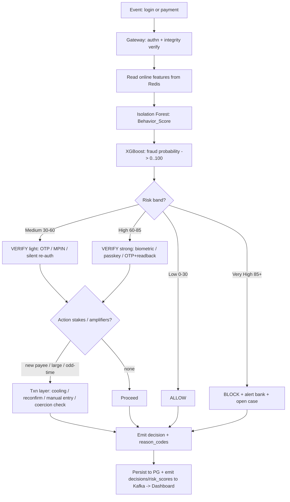
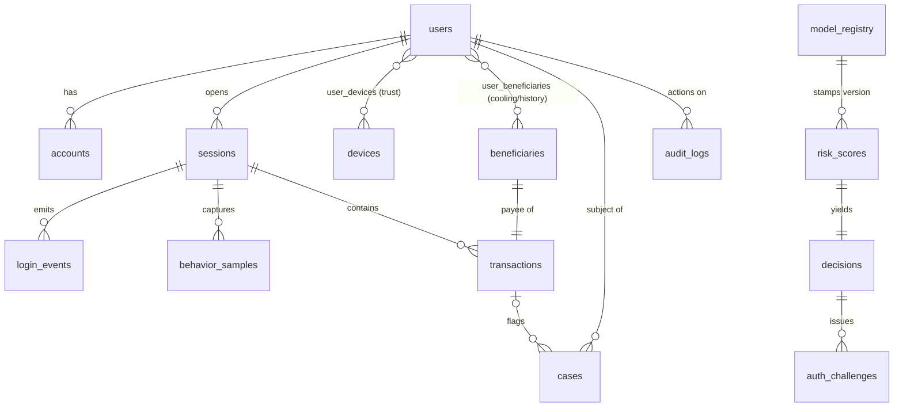
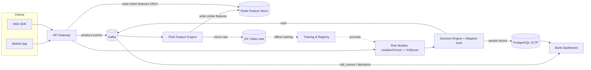

# Product Requirements Document (PRD)

## Project: **CogniGuard** — Real-Time Risk Orchestration Platform for Digital Banking

**Document type:** End-to-end product & engineering specification (build-ready)
**Version:** 3.0 (AE-primary + native Android)
**Status:** Finalized for implementation
**Date:** 2026-06-21
**Authoritative scope note:** This version **removes** the graph database and
graph-based mule-network detection entirely. They are out of scope for **all** phases.
The behavioral model stack is **AE-primary / IF-shadow-fallback**: an **LSTM
Autoencoder** (reconstruction error → calibration layer → `Behavior_Score`) is the
primary behavioral signal — served via ONNX Runtime in the gateway and **TensorFlow
Lite on-device on a native Android app**; **Isolation Forest** (unsupervised) runs in
permanent shadow and is the cold-start/degraded-mode fallback. `Behavior_Score` stacks
into **XGBoost** (primary, supervised) as before. A dedicated Transformer sequence
model remains a **Phase 2** enhancement only (the original "LSTM is Phase 2" framing
shipped ahead of schedule as the AE described above — see §8).

---

## 1. Executive Summary

**Product thesis.** CogniGuard is a **real-time risk *orchestration* layer** that sits in
front of a bank's existing authentication and payment rails. It does not merely score
a transaction in isolation — it **continuously scores both the login session and every
transaction**, fuses behavioral, device, network, transaction, and historical signals
into a single calibrated risk number, and then **drives a decision**: *allow*, *verify*
(adaptive step-up authentication), or *block*. Risk is treated as a property of the
*whole session over time*, not a one-shot gate: a login that scored Low can still
escalate later in the same session because of a new device, an unusual transfer, an
abnormal interaction rhythm, remote-control signatures, or coercion indicators.

**Problem.** Static credentials (passwords, PINs, OTPs) are routinely phished, leaked,
SIM-swapped, or replayed, so traditional authentication cannot reliably separate a
fraudster from the genuine owner. Worse, the fastest-growing loss class is
**authorized-push-payment (APP) fraud and social-engineering / "digital arrest" scams**,
where the *genuine* customer is coerced into pressing *send* — identity-only checks wave
these through because the person, device, and behavior are all legitimate. Banks need a
layer that decides on **risk and intent**, in real time, within tight latency budgets.

**Target users.**
- **Issuing banks** (the buyer) — want fraud loss reduction without degrading the
  genuine-customer experience or breaching latency SLAs.
- **Fraud-operations analysts** (the daily operator) — need real-time visibility,
  per-decision explainability, and the ability to act (block/unblock, case management).
- **End customers** (the protected party) — want frictionless access when they are safe
  and a meaningful circuit-breaker when they are being defrauded.

**Core outcome metric.** **Fraud loss reduction at a bounded false-positive rate and a
bounded step-up rate** — i.e., catch materially more fraud value while keeping genuine
customers friction-free and keeping analyst workload sustainable, all inside
**p95 login latency < 300 ms** and **p95 payment latency < 500 ms**.

---

## 2. Goals, Non-Goals, and Success Metrics

### 2.1 Goals (quantified)

| ID | Goal | Target |
|----|------|--------|
| G1 | **Fraud catch rate** (value-weighted recall on confirmed fraud) | ≥ 80% of fraud *value* caught at the chosen threshold |
| G2 | **False-positive rate** (genuine sessions wrongly escalated to block) | ≤ 1% of genuine high-value events blocked |
| G3 | **Step-up rate** (genuine sessions sent to `verify`) | ≤ 5% of genuine logins see added friction (≈ 95% zero-friction) |
| G4 | **Login decision latency** | **p95 < 300 ms** (server-side, gateway-in to decision-out) |
| G5 | **Payment decision latency** | **p95 < 500 ms** (server-side, gateway-in to decision-out) |
| G6 | **Model quality (biometric anomaly core)** | EER ≤ 10% on reference behavioral benchmarks |
| G7 | **Explainability coverage** | 100% of `verify`/`block` decisions carry machine- and human-readable reason codes |
| G8 | **Throughput** | Sustain ≥ 2,000 scoring events/sec/region at the latency SLOs (horizontally scalable) |

### 2.2 Non-Goals

- CogniGuard is **not a core banking ledger** — it does not hold balances or move money; it
  reads context and returns a decision. The bank's core executes (or halts) the payment.
- CogniGuard is **not a KYC/identity-proofing provider** — it consumes KYC level as a signal
  but does not perform onboarding identity verification.
- CogniGuard is **not an OTP/SMS gateway** — it *orchestrates* which factor is challenged;
  the bank's existing factor providers execute the challenge.
- **For this version, CogniGuard does NOT perform graph-based mule-network detection.**
  There is no graph database and no graph model. (A reputation list of flagged
  beneficiaries is a future enhancement, not a graph feature.)
- Not a regulatory **certification**; CogniGuard bakes in *structural* compliance controls
  (audit, consent, residency) but does not constitute legal advice (see §13).

### 2.3 Success Metrics (how we measure the goals)

- **Primary:** fraud-value-loss-averted ÷ fraud-value-attempted, measured against
  analyst-confirmed labels, at a fixed step-up budget.
- **Guardrail:** genuine-customer friction rate and block-false-positive rate must stay
  under G2/G3 while G1 is optimized — a single threshold is tuned against all three.
- **Operational:** p95/p99 latency per path (login, payment), availability per stage,
  and analyst time-to-resolution on cases.

---

## 3. Personas & Key Journeys

| Persona | Who they are | Primary journey | What CogniGuard must do |
|---------|--------------|-----------------|----------------------|
| **Genuine customer** | Real account holder on mobile/web | Log in → browse → pay a known payee | Be invisible: Low risk → `allow`, no friction |
| **Fraudster — Account Takeover (ATO)** | Holds stolen/phished/SIM-swapped credentials, different device/geo/behavior | Logs in cleanly, attempts transfer | Catch via device/geo/behavior anomaly even with **zero failed passwords** → `verify`/`block` |
| **Fraudster — Social engineering / coercion / duress** | The **genuine** customer, coerced over a phone call ("digital arrest", fake-officer/refund scam) into transferring their own money | Adds new payee, sends large amount at odd hour | Identity signals are clean, so catch via **transaction context + duress indicators** → coercion-aware step-up |
| **Fraudster — Remote control (RAT)** | Attacker drives the genuine device remotely / replays captured telemetry | In-session takeover | Catch via continuous re-scoring, telemetry anti-replay, and interaction-signature anomaly → downgrade/terminate session |
| **Bank fraud analyst** | Fraud-ops / SOC staff | Triage HIGH events, investigate, resolve | Real-time feed, reason codes, case actions (block/unblock, assign, note), feedback labels into training |

### 3.1 End-customer journeys (happy and adverse)

1. **Genuine happy path.** Known device, known geo, normal behavior, known payee →
   login Low → `allow`; payment Low → `allow`. ~95% of logins land here.
2. **ATO at login.** Valid creds, new device, impossible-travel geo → login High →
   `verify` with a strong, phishing-resistant factor, or `block` + alert.
3. **Coercion at payment (the signature case).** Genuine login (Low), but later a
   large transfer to a payee added minutes ago, at an atypical hour, with prolonged
   pre-transfer hesitation → payment risk amplified to High → coercion-aware
   confirmation + cooling period.
4. **Mid-session hijack.** Login Low, then behavioral discontinuity / remote-control
   signature mid-session → continuous score spikes → session downgraded/terminated.

---

## 4. Product Scope & the Continuous-Risk Principle

**Risk is re-evaluated throughout the session — not just at the login gate.** This is the
defining product principle and it shapes the architecture (streaming, not batch).

- A genuine login (Low risk, all biometrics green) can still **escalate later** due to:
  a **new device** appearing mid-session, an **unusual transfer** (new payee, large
  amount, drain), **abnormal typing/touch rhythm**, **remote-control signatures**
  (input timing inconsistent with human interaction, replayed telemetry), or
  **coercion indicators** (atypical hour + prolonged dwell + dictation-shaped, hesitant
  entry — the scam-call signature).
- Conversely, a borderline login can **de-escalate** if subsequent behavior re-converges
  to the user's baseline (silent re-authentication).

**In scope (MVP):** continuous login-session scoring; per-transaction scoring; adaptive
authentication orchestration; the allow/verify/block decision engine; streaming feature
computation; XGBoost + Isolation Forest models; explainability; analyst dashboard +
case actions; model governance/feedback loop.

**Explicitly out of scope (this version):** any graph database and graph-based
mule-network detection — removed from all phases.

---

## 5. System Architecture (End-to-End)

CogniGuard is a **streaming ML** system. Signals flow as events through a durable log; a
stream processor computes features into a low-latency store; models read **only** that
store at inference time; the decision engine acts and emits decisions back to the bank.

```
                         ┌──────────────────────── Bank / Analysts ───────────────────────┐
                         │                         Bank Dashboard                          │
                         └───────────────▲───────────────────────────────▲────────────────┘
                                         │ decisions / risk_scores (WS)   │ cases, audit (PG read)
 ┌───────────┐   HTTPS    ┌───────────┐  │  produce   ┌───────────────┐   │
 │  Mobile   ├───────────►│   API     ├──┼───────────►│     Kafka     │   │
 │  App /    │  signed    │  Gateway  │  │  events    │ (event log)   │   │
 │  Web SDK  │  payload   │ (FastAPI) │  │            └──────┬────────┘   │
 └───────────┘            └─────┬─────┘  │                   │ consume    │
                                │        │                   ▼            │
                                │        │           ┌───────────────┐    │
                                │        │           │  Flink Feature│    │
                                │        │           │    Engine     │    │
                                │        │           └──────┬────────┘    │
                                │        │     write features│            │
                                │        │                   ▼            │
                                │        │           ┌───────────────┐    │
                                │  online read (ONLY)│  Redis Feature│    │
                                │  ◄─────────────────┤     Store     │    │
                                ▼                    └───────────────┘    │
                       ┌─────────────────┐                               │
                       │  Risk Models     │  Isolation Forest ─► anomaly  │
                       │  (scoring svc)   │  XGBoost ─► fraud probability  │
                       └────────┬─────────┘                               │
                                │ score                                   │
                                ▼                                         │
                       ┌─────────────────┐  allow / verify / block       │
                       │ Decision Engine  ├───────────────────────────────┘
                       │ + Adaptive Auth  │
                       └────────┬─────────┘
                                │ durable write (system of record)
                                ▼
                       ┌─────────────────┐        ┌──────────────────────┐
                       │   PostgreSQL     │        │   S3 / Data Lake     │
                       │   (OLTP record)  │        │ (raw archive, train) │
                       └─────────────────┘        └──────────────────────┘
```

**Pipeline (canonical):**
`Mobile App → API Gateway → Kafka → Flink Feature Engine → Redis Feature Store → Risk
Models → Decision Engine → Bank Dashboard.`

**Streaming, not batch.** Features are computed continuously by Flink from the Kafka
event log and written to Redis as they change. Inference reads pre-computed online
features from Redis — it never recomputes windows on the request path and never queries
PostgreSQL. Batch jobs exist only **offline** (training, analytics) over S3.

### 5.1 Component responsibilities

| Component | Responsibility |
|-----------|----------------|
| **Mobile App / Web SDK** | Capture behavioral/device/network signals; emit a signed, session-bound payload; on mobile, do edge feature extraction and send only derived features (privacy + latency). |
| **API Gateway (FastAPI)** | Terminate TLS, authenticate request, validate payload integrity (single-use nonce + HMAC, anti-replay), produce events to Kafka, call scoring + decision synchronously for the gating decision, return allow/verify/block. |
| **Kafka** | Immutable, partitioned event log; decouples ingestion from processing; replayable for rebuilds and training archive. |
| **Flink Feature Engine** | Stateful stream processing: windowed velocity/sum counters, geo-distance, z-scores, baseline deviation; writes online features to Redis; mirrors raw events to S3. |
| **Redis Feature Store** | The **only** store models read at inference time; holds online features/counters with TTLs. |
| **Risk Models (scoring service)** | Run Isolation Forest (anomaly) then XGBoost (fraud probability, consuming the anomaly score); return calibrated score + reason codes. |
| **Decision Engine + Adaptive Auth** | Map score band to action; select the lightest factor that clears the risk; apply transaction-layer controls (cooling/reconfirm/manual-entry/coercion-check); emit decision. |
| **PostgreSQL** | System of record (written for the record; read by dashboards/analysts) — never on the hot path. |
| **S3 / Data Lake** | Raw event archive, historical feature snapshots, labeled training sets, model artifacts. |
| **Bank Dashboard** | Real-time event/alert feed (WebSocket from `decisions`/`risk_scores` topics), per-user history, case management, policy tuning. |

### 5.2 Request/response sequence — **Login scoring** (budget p95 < 300 ms)

```
Client                  Gateway            Kafka      Redis        Models        Decision
  │  login + payload       │                 │          │             │              │
  ├───────────────────────►│                 │          │             │              │
  │            (1) authn + nonce/HMAC verify  │          │             │              │
  │                        ├─ produce login_event ─────► │             │              │
  │                        ├──── read online features ──►│             │              │
  │                        │◄──── features (HASH/SET) ───┤             │              │
  │                        ├──────── score(features) ───────────────► │              │
  │                        │   IsolationForest→anomaly; XGBoost→p      │              │
  │                        │◄────────── score + reasons ──────────────┤              │
  │                        ├──────────── decide(score) ──────────────────────────►   │
  │                        │◄──── action: allow | verify(factors) | block ───────────┤
  │◄── decision (+ challenge if verify) ─────────────────────────────────────────────┘
  │                        └─ async: write risk_scores/decisions to PG + Kafka topics
```

Latency budget per hop in §12.1. (Flink consumes `login_event` asynchronously to keep
Redis warm for *subsequent* events; the *current* decision uses the features already
present in Redis plus the inline payload — the hot path never blocks on Flink.)

### 5.3 Request/response sequence — **Payment scoring** (budget p95 < 500 ms)

```
Client                  Gateway            Kafka      Redis        Models        Decision
  │ initiate payment       │                 │          │             │              │
  ├───────────────────────►│                 │          │             │              │
  │         (1) authn + nonce/HMAC verify; load session context        │              │
  │                        ├─ produce transaction_event ─► │           │              │
  │                        ├──── read features: amount_z, velocity,     │              │
  │                        │       geo, beneficiary_risk, behavior ────►│             │
  │                        │◄──── feature bundle ─────────┤             │              │
  │                        ├──────── score(features) ───────────────► │              │
  │                        │  IF anomaly → XGBoost fraud probability    │              │
  │                        │◄────────── score + reasons ──────────────┤              │
  │                        ├──────────── decide(score, action stakes) ───────────► │  │
  │                        │   allow | verify(cooling/reconfirm/manual/coercion) |   │
  │                        │   block + alert bank                                    │
  │                        │◄─────────────── action + required_factors ──────────────┤
  │◄── decision (+ step-up / cooling / coercion screen) ─────────────────────────────┘
  │                        └─ async: persist txn, risk_score, decision; emit topics
```

---

## 6. Data Flow & Collection

Inputs are organized into five domains. For each raw signal we note its **source**
(client SDK vs. server vs. enrichment service) and **capture frequency**.

### 6.1 User-Behavior domain

| Raw signal | Source | Frequency |
|------------|--------|-----------|
| Typing speed (keystrokes/sec), inter-key latency vector (typing rhythm), key-latency avg | Client SDK | Per login + periodic in-session batches |
| Swipe angle/velocity/curvature, touch pressure/contact area | Client SDK (mobile, edge-extracted) | Continuous while interacting; sent as derived features |
| Mouse velocity / trajectory (web) | Client SDK (web) | Continuous while interacting |
| Session duration, navigation flow, pre-transaction dwell, hesitation/correction rate | Client SDK + server session tracking | Continuous |

> On mobile, raw coordinate/sensor time-series are **extracted on-device** and only the
> derived feature vector is transmitted (data minimization at the source).

### 6.2 Device domain

| Raw signal | Source | Frequency |
|------------|--------|-----------|
| Device fingerprint, OS/OS version, browser, app version | Client SDK | Per session |
| `is_rooted` (root/jailbreak), `is_emulator` | Client SDK | Per session |
| Per-user device trust, first/last seen | Server (derived) + enrichment | On change |

### 6.3 Network domain

| Raw signal | Source | Frequency |
|------------|--------|-----------|
| IP address, ASN, VPN/proxy flag | Server + IP-enrichment service | Per request |
| Geo (lat/lon, city, country) | IP-geo enrichment service | Per request |

### 6.4 Transaction domain

| Raw signal | Source | Frequency |
|------------|--------|-----------|
| Amount, currency, transfer type (IMPS/NEFT/RTGS/UPI), channel | Server (payment request) | Per transaction |
| Beneficiary id, `is_new_payee` | Server (lookup vs. known set) | Per transaction |
| Timestamp / transaction hour | Server | Per transaction |

### 6.5 Historical-context domain

| Raw signal | Source | Frequency |
|------------|--------|-----------|
| 30-day avg/std amount, txn count, baseline geohash | Flink-derived, stored in Redis profile (durable copy in PG/S3) | Rolling, updated by stream |
| Known devices / beneficiaries / geos sets | Flink-derived in Redis (durable in PG) | On change |
| Velocity counters (1h/24h), 24h amount sum | Flink-derived in Redis with TTL | Continuous |

**Collection rule:** all raw events land on Kafka (durable, replayable) and are mirrored
to S3 for archive/training. Flink turns them into the online features in Redis. The
client→gateway payload is always **session-bound and integrity-protected** (single-use
nonce + HMAC + monotonic sequence + timestamp-skew check) to defeat capture-and-replay
(remote-control / MITM) attacks.

### 6.6 Training Data Sources & Dataset Strategy

CogniGuard's models are trained from four sources: two bank-provided operational datasets
and two reference behavioral-biometrics corpora. In production, these are superseded
progressively by live streaming data, but they seed both offline training and the global
cold-start priors.

#### Bank-provided datasets

**`INB_REQ_LOG`** (Internet Banking Request Log)

- **What it is:** Server-side log of every INB request — user ID, session token, service
  type (`INB_SERVICE_ID`), handle (`INB_HANDLE_ID`), request timestamp, and status.
- **Key fields used:** `INB_USER_ID`, `INB_SESSION_ID` (epoch timestamp embedded in token),
  `INB_HANDLE_ID` (navigation action: `WELCOME`, `201_RTGS`, `203_RTGS`, `BILLPAY_INPUT`,
  etc.), `INB_SERVICE_ID` (`I_ACCQRY`, `C_RTGS`, `I_ONLINEPAY`, `I_PASWRD_AUTH`, etc.),
  `INB_REQUEST_DATE`, `INB_REQUEST_STATUS`.
- **What it trains / derives:**

  | Derived feature | Derivation from log |
  |-----------------|---------------------|
  | `session_duration` | `max(INB_REQUEST_DATE) − min(INB_REQUEST_DATE)` per `INB_SESSION_ID` |
  | `pre_txn_dwell` | Time between last non-payment request and RTGS/payment handle |
  | `nav_entropy` | Shannon entropy of `INB_SERVICE_ID` sequence per session |
  | `request_velocity` | Request count ÷ session duration (bot/RAT indicator) |
  | `beneficiary_add_to_pay_gap` | Minutes from `201_RTGS` (add payee) to `203_RTGS` (execute) in the same session — **primary coercion signal** |
  | `odd_time` | Hour-of-day distribution per `INB_USER_ID` from `INB_REQUEST_DATE` |

- **Models fed:** Isolation Forest (session behavioral vector) + XGBoost (session/navigation
  features).
- **Role in production:** The API Gateway middleware automatically produces equivalent data
  to `behavior_events` and `login_events` Kafka topics on every request — no extra
  instrumentation needed. `INB_REQ_LOG` seeds the offline baseline; live gateway events
  replace it from day one.

---

**`TXN_HISTORY_UPI_FIN`** (UPI Transaction History)

- **What it is:** Historical UPI transaction records per user — amounts, payees,
  timestamps, transfer types, and statuses.
- **What it trains / derives:**

  | Derived feature | Derivation |
  |-----------------|------------|
  | `avg_amount_30d`, `std_amount_30d` | Rolling 30-day per-user stats → used to compute `Amount_zscore` |
  | `velocity_1h`, `velocity_24h` | Sliding window txn counts per user |
  | `amount_sum_24h` | Sliding 24h sum per user |
  | `is_new_payee` | Beneficiary not seen in user's prior history |
  | `beneficiary_risk` | Composite: `is_new + zero_transfer_count + cooling_active` |
  | `odd_time` norms | User's typical transaction-hour distribution |

- **Supervised labeling:** If the dataset carries a fraud label column, use it directly as
  the XGBoost training target. If not, apply heuristic labeling:
  `is_new_payee = True AND amount_zscore > 2 AND odd_time = True` → synthetic fraud
  candidate for initial model training, to be refined by analyst-confirmed labels via the
  feedback loop (§14).
- **Models fed:** XGBoost (primary supervised training set); Flink feature baselines
  seeded into Redis.
- **Role in production:** The bank's payment rail produces equivalent data to
  `transaction_events` Kafka topic in real time; Flink maintains rolling windows in Redis.
  `TXN_HISTORY_UPI_FIN` provides the historical depth (30-day baselines) before enough
  live data accumulates.

---

#### Reference behavioral corpora

**CMU Keystroke Dynamics Dataset**

- **What it is:** Controlled captures of typing behavior across many subjects — inter-key
  latency vectors, key hold times, and flight times on physical and soft keyboards.
- **Features extracted:** `typing_speed`, `key_latency_avg`, `typing_rhythm_std`,
  `hold_time_avg`.
- **How used:**
  - Seeds the **global Isolation Forest prior** for the typing behavioral baseline before
    any per-user enrollment data exists (cold-start coverage — §8.2).
  - Validates **G6 (EER ≤ 10%)** against a published benchmark before deploying to real
    users.
- **Limitation:** Skews toward physical keyboards; mobile soft-keyboard rhythm diverges.
  Per-user enrollment data supersedes this prior after ~10 clean low-risk sessions.

---

**HMOG Dataset** (Hand Movement, Orientation, and Grasp)

- **What it is:** Smartphone sensor captures — touch gestures, hand movement, device
  orientation, and accelerometer data — across tasks performed on mobile devices.
- **Features extracted:** `swipe_velocity_norm`, `swipe_angle_dev`, `touch_pressure_avg`,
  `touch_area_avg`, `acceleration_variance`.
- **How used:**
  - Seeds the **global Isolation Forest prior** for touch/gesture/motion behavioral
    baseline (cold-start coverage on mobile channel — §8.2).
  - Provides population distribution for normalizing per-device-type touch features.
  - Validates behavioral anomaly detection on mobile interaction patterns before live
    enrollment data accumulates.
- **Limitation:** Lab conditions; real banking-app interaction (stressed, hurried,
  coerced) differs. Treat as bootstrapping data only — not a long-term substitute for
  in-app behavioral enrollment.

---

#### Dataset roles summary

| Dataset | Type | Primary model fed | Key features derived | Superseded by |
|---------|------|-------------------|----------------------|---------------|
| `INB_REQ_LOG` | Bank operational | XGBoost + IF | `session_duration`, `pre_txn_dwell`, `nav_entropy`, `request_velocity`, `beneficiary_add_to_pay_gap`, `odd_time` | Live `behavior_events` / `login_events` from API Gateway |
| `TXN_HISTORY_UPI_FIN` | Bank operational | XGBoost (supervised) | `amount_zscore`, `velocity_1h/24h`, `amount_sum_24h`, `is_new_payee`, `beneficiary_risk` | Live `transaction_events` stream → Flink → Redis |
| CMU Keystroke | Reference corpus | IF global prior (typing) | `typing_speed`, `key_latency_avg`, `typing_rhythm_std`, `hold_time_avg` | Per-user enrollment baseline after ≥ 10 clean sessions |
| HMOG | Reference corpus | IF global prior (touch/motion) | `swipe_velocity_norm`, `swipe_angle_dev`, `touch_pressure_avg`, `touch_area_avg`, `acceleration_variance` | Per-user enrollment baseline after ≥ 10 clean sessions |

> **Transition rule:** CMU and HMOG data seed only the global Isolation Forest prior and
> validate G6 in pre-production. Once a per-user baseline accumulates from ≥ 10 low-risk,
> no-step-up sessions, the global prior is replaced by the per-user model for that user.
> The bank-provided datasets seed offline XGBoost training; from day one of production,
> the analyst feedback loop (§14) progressively replaces them with live labeled data.
> Both bank datasets are archived to S3 and treated as the initial partition of the
> training data lake.

---

## 7. Feature Engineering & Feature Catalog

### 7.1 Canonical feature catalog

The following is the authoritative model-input list. For each feature: definition, raw
inputs, computation window, storage location, and consuming model(s).

| Feature | Definition | Raw inputs | Window | Store (key/table) | Consumed by |
|---------|------------|-----------|--------|-------------------|-------------|
| **Amount** | Transaction value | txn event `amount` | point | from event (txn) | XGBoost |
| **Amount_zscore** | `(amount − avg_30d) / std_30d` | amount, profile avg/std | 30d | Redis `user:{id}:profile` | XGBoost |
| **Device_Trust** | Per-user device trust 0..100 | device fingerprint, history | lifetime | Redis `device:{id}:trust` / PG `user_devices.trust_score` | XGBoost |
| **Is_New_Device** | Device not in user's known-devices set | device id, known set | point | Redis `user:{id}:known_devices` | XGBoost, Decision |
| **Geo_Distance** | Haversine(current geo, baseline geo) | geo lat/lon, baseline geohash | point | Redis `user:{id}:profile` (+ `known_geos`) | XGBoost |
| **Geo_Change** | `Geo_Distance` over threshold (boolean) | Geo_Distance | point | derived | Decision layer |
| **Velocity_1h / Velocity_24h** | Txn count in window | txn events | 1h / 24h | Redis `user:{id}:velocity:1h` / `:24h` | XGBoost |
| **Amount_Sum_24h** | Sum of amounts in window | txn events | 24h | Redis `user:{id}:amount_sum:24h` | XGBoost |
| **Beneficiary_Risk** | New payee? cooling active? prior history? | beneficiary id, cooling, history | point | Redis `user:{id}:known_beneficiaries` (+ PG `user_beneficiaries`) | XGBoost, Decision |
| **Is_New_Payee** | Beneficiary not in user's known set | beneficiary id, known set | point | Redis `user:{id}:known_beneficiaries` | Decision layer |
| **Behavior_Score** | Calibrated anomaly score vs. biometric baseline | typing/touch/swipe/session (a rolling `(16,9)` window) | session | AE-primary: LSTM Autoencoder reconstruction error → calibration layer (Redis `behavior:{id}:ae_calib` / `calib:ae:population`). Shadow/fallback: Isolation Forest output (baseline in Redis `behavior:{id}:baseline`) | XGBoost (stacked) / Ensemble 25% |
| **Odd_Time** | Txn hour outside user's norm | txn hour, user norm | point | derived | Decision layer |
| **High_Velocity** | Velocity over threshold (boolean) | Velocity_1h/24h | point | derived | Decision layer |
| **Sequence_Risk** | LSTM/Transformer over last N **transactions** (**Phase 2** — distinct from the shipped behavioral autoencoder, which sequences biometric events, not transaction history) | recent txn history | rolling | model output | XGBoost (Phase 2) |

**Rules the engine must respect:**
- Online features are read **only from Redis** at inference. The PostgreSQL tables (§11)
  are the durable record and the cold-start rebuild source for Redis.
- The **decision-layer features** (`Is_New_Payee`, `Geo_Change`, `Odd_Time`,
  `High_Velocity`, `Is_New_Device`, and a Large-Amount flag) are also the **explicit
  triggers** for the transaction-fraud layer (Cooling Period, Reconfirmation, Manual
  Amount Entry, Coercion Check) in §10.

### 7.2 Feature Lineage / Relationships (raw → derived → model → score)

```
RAW SIGNALS                  DERIVED FEATURES                  MODEL
typing_speed,   \                                       ┌─► LSTM Autoencoder (primary)─┐
typing_rhythm,   >─────────► (16,9) behavioral window ──┤                              ├─► Calibration Layer
touch, swipe    /                                       └─► Isolation Forest (shadow) ─┘        │
                                                           (cold-start/degradation fallback)      ▼
                                                                                            Behavior_Score
                                                                                                   │
device fingerprint,\                                                 │ (fed in as                │
is_rooted           >──────► Device_Trust, Is_New_Device ──┐         │  one feature)              │
                                                           │         ▼                            │
amount, ts,        \         Amount_zscore, Velocity_1h/24h│   ┌───────────────┐                  │
beneficiary_id,     >──────► Amount_Sum_24h, Geo_Distance, ├──►│   XGBoost      │◄─────────────────┘
ip/geo, is_new_payee/        Beneficiary_Risk              │   │  (PRIMARY)     │
                                          + Behavior_Score ┘   │ ⇒ fraud prob.  │
                                                              └──────┬─────────┘
                                                                     ▼
                              risk bands ► Decision Engine ► Allow / Verify / Block
```

**Stacking (recommended):** `Behavior_Score` — AE-primary, Isolation-Forest-shadow-and-
-fallback — is fed in as **one input feature** to XGBoost. XGBoost emits a **single
fraud probability** → one threshold to tune (see §8, §9). Decision-layer booleans are
computed alongside and routed to the transaction-fraud layer.

---

## 8. Machine Learning Models

Four models, of which **three are MVP** and **one is Phase 2**. For each: inputs, output,
training-data source, retraining cadence, and cold-start fallback.

### 8.1 Model 1 — XGBoost (PRIMARY, supervised) — *drives the final decision*

- **Role:** supervised gradient-boosted trees for transaction fraud, login fraud, and
  overall risk scoring. **This model produces the final fraud probability that the
  Decision Engine acts on.**
- **Inputs:** Amount, Amount_zscore, Device_Trust, Is_New_Device, Geo_Distance,
  Velocity_1h/24h, Amount_Sum_24h, Beneficiary_Risk, and **`Behavior_Score`** — stacked
  in as one feature, regardless of whether Model 2 (AE) or Model 3 (IF) produced it.
  (Phase 2 adds Sequence_Risk from Model 4.)
- **Output:** calibrated **fraud probability** in [0,1] → scaled to 0–100 risk score.
- **Training data:** labeled historical transactions/logins from S3 (analyst-confirmed
  fraud / false-positive labels via the §14 feedback loop), joined with historical
  feature snapshots so training features match online features.
- **Retraining cadence:** scheduled **weekly** retrain + **on-demand** retrain when drift
  monitors fire; champion/challenger before promotion (§14).
- **Cold-start fallback:** before enough labels accumulate, XGBoost runs with a
  conservative threshold and **leans on `Behavior_Score`** (Model 2/3) plus the
  decision-layer rules; for a brand-new user with no profile, biometric weight is
  redistributed to context features and decisions **bias to `verify`, never `block`**.

### 8.2 Model 2 — LSTM Autoencoder (PRIMARY behavioral signal, unsupervised)

- **Role:** the **primary** source of `Behavior_Score`. An unsupervised sequence
  autoencoder — trained **only on genuine sessions** — that reconstructs a rolling
  `(16, 9)` window of the same 9-dim behavioral vector (typing rhythm, touch dynamics,
  swipe angle, session duration) Model 3 uses; a high **reconstruction error** means the
  live window doesn't look like the user's genuine behavior.
- **Architecture:** `Input(16,9) → Masking → LSTM(32)→LSTM(16) → RepeatVector →
  LSTM(16,seq)→LSTM(32,seq) → TimeDistributed(Dense(9))`, masked-MSE loss.
- **Serving:** ONNX Runtime in the gateway (web sessions; assembles the rolling window
  server-side from the Redis-backed sequence buffer) and **TensorFlow Lite on-device on
  the native Android app** (NFR-10 — only the raw reconstruction error crosses the wire,
  never the window itself).
- **Output:** raw reconstruction error (≥0, unbounded) → the shared **calibration
  layer** (robust-z → logistic, anchored to a fitted threshold/scale) → `Behavior_Score`
  in [0,1], same polarity as Model 3's calibrated output.
- **Training data:** pooled genuine CMU (typing) + HMOG (touch/motion) sequences,
  windowed per-subject; never trained on step-up-passed (quarantined) telemetry.
- **Retraining cadence:** offline, on-demand (`training/train_lstm_autoencoder.py`);
  registers both the ONNX and TFLite artifacts together under one version stamp.
- **Cold-start fallback:** fewer than `MIN_SEQ` real rows in the rolling window, or no
  calibration available yet for that user/population, routes `Behavior_Score` to
  **Model 3 (Isolation Forest)** instead — never an outright `block`.

### 8.3 Model 3 — Isolation Forest (SHADOW signal; cold-start/degradation fallback, unsupervised)

- **Role:** unsupervised anomaly detection — **needs no labels**. Runs on **every**
  event regardless of which source is primary: while Model 2 has a usable calibration,
  Isolation Forest's score is computed and logged (`if_shadow_score`) for drift
  comparison but never acted on; it **becomes** the live `Behavior_Score` source on
  AE cold-start or AE failure/timeout (`degraded_mode`). It also catches **novel
  fraud** patterns no label has yet described.
- **Inputs:** the same behavioral feature vector (typing/touch/swipe/session) vs. the
  user's stored biometric baseline; plus transaction/context features for generic
  novelty.
- **Output:** **anomaly score** (`decision_function`, sign-flipped) → through the same
  calibration layer as Model 2 → `Behavior_Score` in [0,1].
- **Training data:** the user's enrollment + accepted (non-quarantined) behavior samples
  (per user / per channel), plus reference behavioral datasets for the global prior.
- **Retraining cadence:** per-user incremental update from LOW-risk, no-step-up sessions;
  global model retrained with XGBoost on the weekly cadence.
- **Cold-start fallback:** for a new user, use the **global** anomaly model until a
  per-user baseline is established; first use on a new channel is cold-start →
  `verify`, never `block`, and seeds a fresh baseline.

> **Anti-poisoning (preserved from prior design):** telemetry from any session that
> required a step-up to pass is **never** fed straight into the baseline or into AE/IF
> training. It is held in a quarantine store and promoted only after a clean cooling
> window (no fraud complaint, chargeback, anomalous device/geo change, or subsequent
> high-risk event). See §14.

### 8.4 Model 4 — LSTM / Transformer (PHASE 2 ONLY, transaction-sequence model)

- **Role (later enhancement, NOT in the MVP):** a sequence model over the user's recent
  **transaction history** to catch **sudden pattern shifts** that point-in-time features
  miss — e.g., a sequence `1000 → 2000 → 1500 → 50000` where the last transfer breaks the
  established rhythm. Distinct from Model 2's behavioral autoencoder, which sequences
  biometric events within a single session, not transactions across sessions.
- **Inputs:** ordered sequence of the user's last *N* transactions (amount, type, payee
  novelty, inter-transaction time, etc.).
- **Output:** **Sequence_Risk** in [0,1], fed into XGBoost as an additional feature.
- **Training data:** sequences assembled from S3 transaction history.
- **Retraining cadence:** scheduled, less frequent than XGBoost; gated behind
  champion/challenger.
- **Cold-start fallback:** if a user has fewer than *N* transactions, `Sequence_Risk`
  defaults to neutral and XGBoost relies on its other features.
- **Status:** **Phase 2.** Not part of the production MVP.

### 8.5 Recommended integration pattern — **STACKING**

`Behavior_Score` is **AE-primary** (Model 2) with **Isolation Forest** (Model 3) as a
permanent shadow signal and the cold-start/degradation fallback; whichever source wins,
it's fed in as **one input feature** to **XGBoost**. The result is a **single fraud
probability** and therefore **one threshold to tune** — simpler to calibrate, monitor,
and explain than two parallel scores. This is the recommended pattern and the default
in the MVP. (An alternative weighted-ensemble pattern, for teams that prefer it, is
described in §9.2.)

| Model | MVP? | Inputs | Output | Retrain | Cold-start fallback |
|-------|------|--------|--------|---------|---------------------|
| XGBoost | ✅ Primary | context + txn + Behavior_Score (+ Seq P2) | fraud probability | weekly + on-drift | conservative threshold; lean on Behavior_Score + rules; bias to verify |
| LSTM Autoencoder | ✅ Behavioral primary | `(16,9)` behavioral window | reconstruction error → Behavior_Score | offline, on-demand | routes to Isolation Forest on cold-start/failure |
| Isolation Forest | ✅ Behavioral shadow + fallback | behavioral + context vectors | anomaly score → Behavior_Score | per-user incremental + weekly global | use global model; new channel → verify, seed baseline |
| LSTM/Transformer | 🔶 Phase 2 | last *N* txn sequence | sequence risk | scheduled | neutral when < N txns |

---

## 9. Risk Scoring

### 9.1 PRIMARY (recommended) — Stacked single-score

The **final fraud probability comes from XGBoost**, which **already consumes
`Behavior_Score` as a feature** — AE-primary, Isolation-Forest-shadow-and-fallback.
There is **one number and one threshold**. This is the recommended production scoring
approach.

```
ae_score, ok    = LSTMAutoencoder(behavioral_window)        # [0,1], via calibration layer
if_score        = IsolationForest(behavioral_vector)        # [0,1], via calibration layer — always computed
Behavior_Score  = ae_score if ok and not ae_cold_start else if_score
final_p         = XGBoost(context, txn, Behavior_Score)     # [0,1]
final_risk      = round(100 * final_p)                       # 0..100
```

### 9.2 ALTERNATIVE — Weighted ensemble (rebalanced; graph model removed)

For teams that prefer an explicit weighted blend over stacking, CogniGuard supports a
weighted ensemble. With the graph model removed, the weights are **rebalanced** as:

| Sub-score | Source | Weight |
|-----------|--------|--------|
| **Transaction** | XGBoost | **60%** |
| **Behavior anomaly** | Isolation Forest | **25%** |
| **Device** | device trust / device signals | **15%** |

```
final_risk = 100 * clamp( 0.60·Transaction + 0.25·Behavior + 0.15·Device , 0, 1 )
```

> Use **either** §9.1 (stacked, recommended) **or** §9.2 (weighted) — not both at once.
> Stacking gives one threshold; the weighted ensemble gives directly inspectable
> sub-score contributions. The weights are Admin-configurable.

### 9.3 Risk bands (both approaches)

| Band | Range | Default action |
|------|-------|----------------|
| **Low** | 0–30 | Allow |
| **Medium** | 30–60 | Verify — light-friction step-up |
| **High** | 60–100 | Verify — strong step-up (and transaction-layer controls) |
| **Very High** | upper sub-range of High (default ≥ 85, configurable) | **Block + alert bank** |

The Very High band is a configurable sub-range at the top of High that triggers an
outright block; the High/Very-High split, like all thresholds, lives in the active
policy. **Transaction-context amplifiers** (new-payee high-value, rapid fan-out,
drain/max-out, coercion time-pattern) can elevate the band multiplicatively at
transaction time even when identity behavior looks normal — this is how APP-fraud /
coercion is caught (see §10.3).

---

## 10. Decision Engine & Adaptive Authentication

The Decision Engine maps the final risk band (and the action's stakes) to one of
**allow / verify / block**, selecting the **lightest factor that clears the measured
risk** (assurance-ordered, not merely least-annoying).

### 10.1 Band → action → factor ladder

| Band | Action | Adaptive-auth factor(s) |
|------|--------|-------------------------|
| **Low** (0–30) | **Allow** | None — seamless |
| **Medium** (30–60) | **Verify (light)** | **OTP / MPIN** — or silent behavioral re-auth if behavior re-converges |
| **High** (60–100) | **Verify (strong)** | **Fingerprint / Passkey / OTP / Voice Readback** (phishing-resistant preferred) |
| **Very High** (≥ 85) | **Block + Alert Bank** | Out-of-band "was this you?"; case opened for analyst |

**Assurance ordering** (pick the lightest that clears the risk): knowledge factors
(password/PIN — weak, phishable) < possession factors (OTP/push — medium; SMS-OTP is
SIM-swappable) < phishing-resistant factors (device biometric / passkey / FIDO2 —
strong). Higher risk or a more sensitive action demands a higher-assurance factor.

**Factor degradation:** if a factor is unavailable (no biometric hardware, no enrolled
fingerprint), fall back to the next factor of **equal-or-higher** assurance — never
silently downgrade below the band's required strength.

### 10.2 Risk × Action matrix (same risk, different friction by stakes)

The same risk score demands different friction depending on what the customer is trying
to do. Sensitive actions (large/new-payee transfers, changing registered mobile/email,
raising limits) are always scrutinized.

| Risk ↓ / Action → | Low-stakes (view balance) | Medium-stakes (add payee, small transfer to known payee) | High-stakes (large/new-payee transfer, change contact, raise limit) |
|---|---|---|---|
| **Low** | Allow | Allow | Verify (medium) + cooling-off |
| **Medium** | Allow / silent re-auth | Verify (medium) | Verify (strong) + out-of-band confirm |
| **High** | Verify (medium) | Verify (strong) | **Block / strong step-up + out-of-band + cooling-off** |

### 10.3 Transaction-fraud layer (controls + triggers)

When the transaction risk score exceeds the threshold (or an amplifier fires), apply the
following **controls**:

- **Cooling Period** — a configurable hold on large transfers to **freshly added**
  payees, so a coerced/late-night addition cannot immediately drain funds.
- **Reconfirmation** — out-of-band "was this you?" confirmation on a separately verified
  channel (registered-app push / email), not the in-session client.
- **Manual Amount Entry** — the customer must **type** the amount (not tap confirm),
  forcing a deliberate pause **and** capturing a fresh high-value behavioral sample at the
  decisive moment.
- **Coercion Check** — a plain-language confirmation screen that names the risk
  (*"You're sending ₹X to a payee added 40 minutes ago — is someone instructing you to do
  this right now?"*).

These controls are fired by the **decision-layer triggers**:

| Trigger | Feature | Typical amplifier |
|---------|---------|-------------------|
| **New Payee** | `Is_New_Payee` | new-beneficiary high-value ×1.5 |
| **Large Amount** | amount vs. baseline / `Amount_zscore` | drain/max-out ×1.3 |
| **Odd Time** | `Odd_Time` | coercion time-pattern ×1.2 |
| **New Device** | `Is_New_Device` | device-trust drop |
| **Geo Change** | `Geo_Change` | impossible-travel elevation |
| **High Velocity** | `High_Velocity` | rapid fan-out ×1.4 |

```
final_score = clamp( base_score × Π amplifierⱼ , 0, 100 )
```

Each fired amplifier and trigger is added to the decision's `reason_codes` for
explainability. Amplifiers apply at **transaction time** via the continuous-scoring path,
not just at login — this is what lets CogniGuard catch *"genuine behavior, dangerous intent."*

### 10.4 Orchestration workflow (Mermaid)



---

## 11. Data Architecture & Storage

### 11.1 Polyglot persistence (which store holds what, and why)

| Store | Holds | Why |
|-------|-------|-----|
| **PostgreSQL (OLTP)** | System of record: users, accounts, devices, sessions, transactions, beneficiaries, risk scores, decisions, auth challenges, cases/alerts, audit logs, model registry | Durable, relational, queried by dashboards/analysts |
| **Kafka (streaming)** | Immutable event log: `behavior_events`, `device_events`, `login_events`, `transaction_events`; output topics `risk_scores`, `decisions` | Decoupling, replay, durability of the event stream |
| **Redis (feature store)** | Low-latency online features and counters consumed by models at inference time | **The only store models read at inference** |
| **S3 / Data Lake** | Raw event archive, historical feature snapshots, labeled training sets, model artifacts | Cheap, large-scale offline training & analytics |

**There is no graph database in this version.**

### 11.2 Hard rules

1. **Inference-time reads hit Redis only.** Models never query PostgreSQL on the hot path.
2. **PostgreSQL is written for the record and read by dashboards/analysts** — never on
   the request path of a scoring decision.
3. **Redis is rebuildable** from PostgreSQL (durable backstop) and Kafka/S3 (replay) on
   cold start — Redis is a cache/derived store, not a source of truth.
4. Raw biometric time-series are minimized at the source (edge extraction on mobile) and
   governed by retention/right-to-be-forgotten lifecycles (see §13).

The full DDL-style schema is in the Appendix (§17.1).

---

## 12. Real-Time Inference Flow & Latency Budget

Both paths share the same hop structure; the payment path has more features and an extra
context load, hence the larger budget.

### 12.1 Login path — target **p95 < 300 ms**

| Stage | Work | Budget (p95) |
|-------|------|-------------|
| 1. Gateway authn + integrity (nonce/HMAC/seq/skew) | verify session-bound payload | ≤ 30 ms |
| 2. Produce `login_event` to Kafka (async, non-blocking) | fire-and-forget for downstream features | ≤ 5 ms (enqueue) |
| 3. Read online features from Redis | profile HASH + known-* SETs + counters | ≤ 40 ms |
| 4. Isolation Forest inference (Behavior_Score) | anomaly on behavioral vector | ≤ 60 ms |
| 5. XGBoost inference (fraud probability) | stacked, consumes Behavior_Score | ≤ 80 ms |
| 6. Decision Engine (band → action → factor) | policy lookup + matrix | ≤ 30 ms |
| 7. Response assembly + async persistence kickoff | return decision; write PG/topics async | ≤ 25 ms |
| **Total (hot path)** | | **≈ 270 ms ≤ 300 ms** |

### 12.2 Payment path — target **p95 < 500 ms**

| Stage | Work | Budget (p95) |
|-------|------|-------------|
| 1. Gateway authn + integrity + session-context load | verify payload; load session | ≤ 40 ms |
| 2. Produce `transaction_event` to Kafka (async) | downstream features | ≤ 5 ms (enqueue) |
| 3. Read online features from Redis | amount_z, velocity, amount_sum, geo, beneficiary, behavior baseline | ≤ 70 ms |
| 4. Isolation Forest inference | anomaly safety net | ≤ 70 ms |
| 5. XGBoost inference (+ amplifiers) | fraud probability + multiplicative amplifiers | ≤ 110 ms |
| 6. Decision Engine + transaction-fraud layer | band, action matrix, cooling/reconfirm/manual/coercion selection | ≤ 60 ms |
| 7. Response assembly + async persistence kickoff | return decision; persist async | ≤ 35 ms |
| **Total (hot path)** | | **≈ 390 ms ≤ 500 ms** |

> Flink feature computation and PostgreSQL/Kafka persistence are **off the hot path**
> (asynchronous). The synchronous decision depends only on Redis reads + model inference
> + policy evaluation.

---

## 13. Non-Functional Requirements

| ID | Category | Requirement |
|----|----------|-------------|
| NFR-1 | **Latency** | Login decision **p95 < 300 ms**; payment decision **p95 < 500 ms** (server-side). |
| NFR-2 | **Throughput** | ≥ 2,000 scoring events/sec/region at the latency SLOs; horizontally scalable by partitioning Kafka and sharding Redis. |
| NFR-3 | **Availability (HA across stages)** | No single point of failure: multi-broker Kafka, Flink with checkpointing, Redis with replicas/cluster, PostgreSQL primary+replica, stateless gateway/scoring behind a load balancer. Target ≥ 99.9% for the decision path. |
| NFR-4 | **Resilience / graceful degradation** | If XGBoost is unavailable, fall back to `Behavior_Score` + decision-layer rules; if the LSTM Autoencoder is unavailable/cold-start, fall back to the Isolation Forest shadow score (always computed); if Redis is degraded, bias to `verify` (never silent allow); if scoring times out, fail to the safe action per policy. |
| NFR-5 | **Security** | TLS in transit; encryption at rest; **PII tokenization** (card/account numbers, contact details); secrets in a managed vault; least-privilege service accounts; parameterized queries; per-session single-use nonce + HMAC anti-replay on every behavioral payload. |
| NFR-6 | **Auditability** | Every decision is immutably logged (event, score, sub-scores, reason codes, action, model version, latency, timestamp) — tamper-evident, queryable, exportable (`audit_logs`, `risk_scores`, `decisions`). |
| NFR-7 | **Explainability** | Every `verify`/`block` decision returns human-readable **reason codes** (e.g., top deviation drivers + fired amplifiers) at near-zero latency (deterministic feature-delta explainer, not heavyweight SHAP/LIME on the hot path). |
| NFR-8 | **Data residency** | All PII and behavioral data stored in-region; cross-border transfer disabled by configuration; per-tenant residency enforced. |
| NFR-9 | **Compliance posture** | Controls **aligned** to RBI Master Direction on Digital Payment Security Controls and the DPDP Act, 2023 (consent logging, minor exclusion, retention expiry, right-to-be-forgotten hard-delete, full decision auditability). **Framed as engineering requirements; legal review is required and this PRD is not legal advice.** |
| NFR-10 | **Privacy / data minimization** | Raw biometric time-series extracted on-device where possible; only derived features transmitted/stored; no raw secret content captured. **Shipped win:** the native Android `capture-sdk` runs the LSTM Autoencoder itself on-device via TensorFlow Lite — the full `(16,9)` behavioral window never leaves the phone, only the single scalar `ae_recon_error` does; the gateway still performs the authoritative calibration server-side. |
| NFR-11 | **Observability** | Structured logs, health endpoints, RED/USE metrics per stage, per-decision latency histograms, drift dashboards. |
| NFR-12 | **Portability / extensibility** | New channels plug in via the same ingestion contract and Kafka topics; infrastructure reproducible via IaC/containers. |

---

## 14. Model Governance & MLOps

- **Model registry (`model_registry`).** Every model (`xgboost_txn`,
  `isolation_forest`, `lstm_autoencoder` (ONNX, gateway), `lstm_autoencoder_tflite`
  (Android) — and a future `lstm_seq` in Phase 2) is registered with version, type,
  stage (`staging | production | archived`), artifact URI (S3), and metrics. The
  scoring service resolves the **production** version at startup and stamps
  `model_version` on every `risk_scores` row.
- **Versioning.** Models, feature definitions, and policies are versioned together so a
  decision can be reproduced exactly from `(model_version, policy_version, feature_set)`.
- **Champion/Challenger.** New models run as **challengers** in shadow against live
  traffic (scoring without acting); they are promoted to **champion** only when they beat
  the incumbent on fraud-value-caught at the bounded FP/step-up budget.
- **Drift monitoring.** Monitor feature drift (PSI/KS on input distributions), score
  drift, and outcome drift (precision/recall on confirmed labels). Threshold breaches
  trigger an alert and an on-demand retrain.
- **Feedback loop.** Analyst-confirmed labels — `cases.status` of `confirmed_fraud` or
  `false_positive` — flow back to S3 as labeled training data. The **weekly XGBoost
  retrain** consumes them; the Isolation Forest baselines update incrementally from
  LOW-risk, no-step-up sessions only. **Quarantine:** step-up-passed telemetry is held in
  a quarantine store and promoted into training only after a clean cooling window
  (no fraud complaint, chargeback, anomalous device/geo change, or subsequent high-risk
  event) — the primary defense against model poisoning.
- **Reproducibility & rollback.** Each promotion is auditable; any production model can be
  rolled back to a prior registry version without redeploying the service.

---

## 15. Phased Rollout

### Phase 1 — Production MVP
- **Stack:** **XGBoost (primary) + LSTM Autoencoder (primary behavioral anomaly net,
  calibrated reconstruction error) + Isolation Forest (permanent shadow + cold-start/
  degraded-mode fallback) + Redis (feature store) + Kafka (event log) + Flink (feature
  engine)**, with PostgreSQL (OLTP) and S3 (data lake). Native Android capture-sdk runs
  the autoencoder on-device (TFLite) alongside the web/server-side ONNX path.
- **Capabilities:** continuous login + transaction scoring; stacked single-score (or
  rebalanced 60/25/15 weighted ensemble); full decision engine + adaptive auth +
  transaction-fraud layer; explainability/reason codes; analyst dashboard + case actions;
  model registry, champion/challenger, drift, feedback loop.
- **Exit criteria:** meets G1–G8 (catch rate, FP/step-up budgets, latency SLOs) on
  shadow then on a controlled live ramp.

### Phase 2 — Sequence modeling
- Add the **LSTM/Transformer transaction-sequence model** (Model 4), feeding
  `Sequence_Risk` into XGBoost to catch sudden pattern shifts across a session's
  transaction history.

> **There is no Phase 3 graph / mule-network stage in this version.** Graph-based
> detection is out of scope for all phases.

---

## 16. Open Questions, Risks & Assumptions

### 16.1 Open questions
- **Threshold calibration:** initial production threshold and the High/Very-High split —
  to be set from the champion model's precision/recall curve on the bank's data.
- **Beneficiary reputation:** should a (non-graph) flagged-VPA reputation list be added in
  Phase 1.5 to make `Beneficiary_Risk` reputation-aware rather than age-only?
- **OTP defeat:** policy for SIM-swap-suspected sessions — when to force phishing-resistant
  factors over SMS-OTP by default.
- **Residency topology:** single-region vs. multi-region active-active for the bank's
  footprint and DR objectives.

### 16.2 Risks & mitigations

| Risk | Mitigation |
|------|-----------|
| Attacker with valid stolen creds never fails a password | Risk-based scoring (device/geo/time/behavior) fires step-up on the **first** attempt; failed-count is only a minor input |
| Account-lockout DoS (attacker fails a victim's password) | Brute-force throttling targets the **offending IP/device, never the account**; sensitive actions are ringfenced |
| APP fraud / coercion (genuine behavior) | Transaction-context amplifiers + coercion check / manual amount entry / cooling at transaction time |
| Model poisoning (stolen creds + intercepted OTP) | Step-up telemetry quarantined; promoted only after clean cooling window |
| Telemetry replay / remote control (RAT, MITM) | Single-use nonce + HMAC + monotonic seq + timestamp-skew rejection |
| Cold start (no labels / no profile) | Isolation Forest + rules carry early period; bias to `verify`, never `block` |
| Model/feature drift | PSI/KS drift monitors → alert + on-demand retrain; champion/challenger gate |
| Latency budget breach | Redis-only inference reads; async persistence; degrade safely on timeout |
| ML engine failure | Rule-based + Isolation Forest fallback (NFR-4) |
| Compliance gap | Consent logging, retention expiry, right-to-be-forgotten, residency, full audit — pending legal review |

### 16.3 Assumptions
- The bank executes the actual payment/auth; CogniGuard returns a decision and the bank
  enforces it.
- Factor providers (OTP/biometric/passkey/voice) exist and are callable by the bank's auth
  stack; CogniGuard orchestrates *which* factor, not the factor delivery itself.
- Enrichment services (IP-geo, ASN, VPN flagging) are available with acceptable latency.
- Sufficient labeled fraud/false-positive history (or a ramp to accumulate it) exists to
  train and calibrate XGBoost; Isolation Forest covers the interim.

---

## 17. Appendix

### 17.1 PostgreSQL schema (DDL-style — OLTP system of record)

```sql
-- ============ Core identity ============
CREATE TABLE users (
  user_id            UUID PRIMARY KEY,
  customer_ref       TEXT UNIQUE,             -- bank customer number
  full_name          TEXT,
  email              TEXT,
  phone              TEXT,
  account_status     TEXT,                    -- active | frozen | closed
  kyc_level          TEXT,
  baseline_risk_tier TEXT,                    -- low | medium | high
  created_at         TIMESTAMPTZ,
  updated_at         TIMESTAMPTZ
);

CREATE TABLE accounts (
  account_id     UUID PRIMARY KEY,
  user_id        UUID REFERENCES users(user_id),
  account_number TEXT UNIQUE,
  account_type   TEXT,                        -- savings | current
  balance        NUMERIC(18,2),
  currency       TEXT,
  status         TEXT,
  opened_at      TIMESTAMPTZ
);

-- ============ Device & session ============
CREATE TABLE devices (
  device_id          UUID PRIMARY KEY,
  device_fingerprint TEXT UNIQUE,
  os                 TEXT,
  os_version         TEXT,
  browser            TEXT,
  app_version        TEXT,
  is_rooted          BOOLEAN,                 -- jailbreak/root status
  is_emulator        BOOLEAN,
  first_seen_at      TIMESTAMPTZ,
  last_seen_at       TIMESTAMPTZ
);

CREATE TABLE user_devices (                   -- M:N binding + per-user trust
  id              UUID PRIMARY KEY,
  user_id         UUID REFERENCES users(user_id),
  device_id       UUID REFERENCES devices(device_id),
  trust_score     NUMERIC(5,2),               -- 0..100
  is_trusted      BOOLEAN,
  binding_status  TEXT,                        -- bound | pending | revoked
  first_linked_at TIMESTAMPTZ,
  last_used_at    TIMESTAMPTZ,
  UNIQUE(user_id, device_id)
);

CREATE TABLE sessions (
  session_id       UUID PRIMARY KEY,
  user_id          UUID REFERENCES users(user_id),
  device_id        UUID REFERENCES devices(device_id),
  ip_address       INET,
  asn              INTEGER,
  is_vpn           BOOLEAN,
  geo_lat          NUMERIC(9,6),
  geo_lon          NUMERIC(9,6),
  geo_city         TEXT,
  geo_country      TEXT,
  login_risk_score NUMERIC(5,2),
  auth_method_used TEXT,
  status           TEXT,                       -- active | ended | terminated
  started_at       TIMESTAMPTZ,
  ended_at         TIMESTAMPTZ
);

CREATE TABLE login_events (
  event_id               UUID PRIMARY KEY,
  session_id             UUID REFERENCES sessions(session_id),
  user_id                UUID REFERENCES users(user_id),
  device_id              UUID REFERENCES devices(device_id),
  event_type             TEXT,                -- attempt | success | failure | step_up
  behavior_anomaly_score NUMERIC(5,2),
  risk_score             NUMERIC(5,2),
  decision               TEXT,                -- allow | verify | block
  created_at             TIMESTAMPTZ
);

CREATE TABLE behavior_samples (               -- raw biometric captures (also archived to S3)
  sample_id       UUID PRIMARY KEY,
  session_id      UUID REFERENCES sessions(session_id),
  typing_speed    NUMERIC,                    -- keystrokes/sec
  typing_rhythm   JSONB,                      -- inter-key latency vector
  key_latency_avg NUMERIC,
  swipe_angle     NUMERIC,
  touch_pressure  NUMERIC,
  mouse_velocity  NUMERIC,
  captured_at     TIMESTAMPTZ
);

-- ============ Beneficiaries & transactions ============
CREATE TABLE beneficiaries (
  beneficiary_id   UUID PRIMARY KEY,
  account_number   TEXT,
  bank_code        TEXT,                       -- IFSC / routing
  name             TEXT,
  beneficiary_type TEXT,
  created_at       TIMESTAMPTZ
);

CREATE TABLE user_beneficiaries (             -- M:N + cooling + history
  id                UUID PRIMARY KEY,
  user_id           UUID REFERENCES users(user_id),
  beneficiary_id    UUID REFERENCES beneficiaries(beneficiary_id),
  is_verified       BOOLEAN,
  cooling_until     TIMESTAMPTZ,               -- new payee cooling period
  transfer_count    INTEGER,
  total_amount_sent NUMERIC(18,2),
  added_at          TIMESTAMPTZ,
  UNIQUE(user_id, beneficiary_id)
);

CREATE TABLE transactions (
  transaction_id         UUID PRIMARY KEY,
  user_id                UUID REFERENCES users(user_id),
  account_id             UUID REFERENCES accounts(account_id),
  session_id             UUID REFERENCES sessions(session_id),
  device_id              UUID REFERENCES devices(device_id),
  beneficiary_id         UUID REFERENCES beneficiaries(beneficiary_id),
  amount                 NUMERIC(18,2),
  currency               TEXT,
  transfer_type          TEXT,                -- IMPS | NEFT | RTGS | UPI
  channel                TEXT,                -- mobile | web
  is_new_payee           BOOLEAN,
  status                 TEXT,                -- initiated | pending | allowed | verified | blocked | reversed
  transaction_risk_score NUMERIC(5,2),
  decision               TEXT,
  decision_reason        JSONB,
  initiated_at           TIMESTAMPTZ,
  completed_at           TIMESTAMPTZ
);

-- ============ Scoring, decisions, challenges ============
CREATE TABLE risk_scores (                    -- one row per scoring event (login or txn)
  score_id          UUID PRIMARY KEY,
  entity_type       TEXT,                      -- login | transaction
  entity_id         UUID,                      -- session_id or transaction_id
  user_id           UUID REFERENCES users(user_id),
  behavior_score    NUMERIC(5,2),              -- from Isolation Forest
  device_score      NUMERIC(5,2),
  transaction_score NUMERIC(5,2),              -- from XGBoost
  final_risk_score  NUMERIC(5,2),
  risk_band         TEXT,                      -- low | medium | high | very_high
  model_version     TEXT,
  latency_ms        INTEGER,
  scored_at         TIMESTAMPTZ
);

CREATE TABLE decisions (
  decision_id      UUID PRIMARY KEY,
  risk_score_id    UUID REFERENCES risk_scores(score_id),
  entity_type      TEXT,
  entity_id        UUID,
  action           TEXT,                       -- allow | verify | block
  required_factors JSONB,                      -- e.g. ["OTP","FINGERPRINT"]
  reason_codes     JSONB,                      -- explainability
  decided_at       TIMESTAMPTZ
);

CREATE TABLE auth_challenges (
  challenge_id   UUID PRIMARY KEY,
  session_id     UUID REFERENCES sessions(session_id),
  decision_id    UUID REFERENCES decisions(decision_id),
  challenge_type TEXT,                         -- OTP | MPIN | FINGERPRINT | PASSKEY | VOICE_READBACK
  status         TEXT,                         -- issued | passed | failed | expired
  attempts       INTEGER,
  issued_at      TIMESTAMPTZ,
  resolved_at    TIMESTAMPTZ
);

-- ============ Fraud-ops & governance ============
CREATE TABLE cases (                          -- fraud-ops alerts / investigations
  case_id        UUID PRIMARY KEY,
  user_id        UUID REFERENCES users(user_id),
  transaction_id UUID REFERENCES transactions(transaction_id) NULL,
  alert_type     TEXT,
  severity       TEXT,
  status         TEXT,                         -- open | investigating | confirmed_fraud | false_positive | closed
  assigned_to    TEXT,
  created_at     TIMESTAMPTZ,
  resolved_at    TIMESTAMPTZ
);

CREATE TABLE audit_logs (
  log_id      UUID PRIMARY KEY,
  actor_type  TEXT,                            -- system | user | analyst
  actor_id    TEXT,
  action      TEXT,
  entity_type TEXT,
  entity_id   UUID,
  metadata    JSONB,
  created_at  TIMESTAMPTZ
);

CREATE TABLE model_registry (
  model_id     UUID PRIMARY KEY,
  model_name   TEXT,                           -- xgboost_txn | isolation_forest | lstm_autoencoder | lstm_autoencoder_tflite | lstm_seq (phase 2)
  model_type   TEXT,
  version      TEXT,
  stage        TEXT,                           -- staging | production | archived
  artifact_uri TEXT,                           -- S3 path
  metrics      JSONB,
  deployed_at  TIMESTAMPTZ
);
```

### 17.2 Redis key reference (online feature store — the only inference-time read store)

| Key pattern | Type | Contents / TTL |
|-------------|------|----------------|
| `user:{user_id}:profile` | HASH | `last_login_ts, last_device_id, avg_amount_30d, std_amount_30d, txn_count_30d, baseline_geohash` |
| `user:{user_id}:known_devices` | SET | device_ids |
| `user:{user_id}:known_beneficiaries` | SET | beneficiary_ids |
| `user:{user_id}:known_geos` | SET | geohashes |
| `user:{user_id}:velocity:1h` | STRING | counter, TTL 1h |
| `user:{user_id}:velocity:24h` | STRING | counter, TTL 24h |
| `user:{user_id}:amount_sum:24h` | STRING | running sum, TTL 24h |
| `device:{device_id}:trust` | STRING | 0..100 |
| `behavior:{user_id}:baseline` | STRING | serialized biometric profile used by the Isolation Forest behavior anomaly check |

> Flink computes and writes these keys; PostgreSQL is the durable backstop used to rebuild
> Redis on cold start.

### 17.3 Kafka topic contracts

**Input topics**

| Topic | Key | Payload |
|-------|-----|---------|
| `behavior_events` | `user_id` | `{ session_id, typing_speed, typing_rhythm, key_latency, swipe_angle, touch_pressure, mouse_velocity, ts }` |
| `device_events` | `device_id` | `{ device_fingerprint, os, app_version, is_rooted, is_emulator, ts }` |
| `login_events` | `user_id` | `{ session_id, device_id, ip, asn, is_vpn, geo_lat, geo_lon, ts }` |
| `transaction_events` | `user_id` | `{ transaction_id, amount, beneficiary_id, transfer_type, is_new_payee, ts }` |

**Output topics**

| Topic | Payload |
|-------|---------|
| `risk_scores` | `{ entity_type, entity_id, behavior_score, device_score, transaction_score, final_risk_score, risk_band, model_version, ts }` |
| `decisions` | `{ entity_type, entity_id, action, required_factors, reason_codes, ts }` |

### 17.4 Entity-relationship description

**Cardinalities:**
- `users` **1—N** `accounts`
- `users` **N—M** `devices` (via `user_devices`, which carries `trust_score`)
- `users` **N—M** `beneficiaries` (via `user_beneficiaries`, which carries cooling/history)
- `users` **1—N** `sessions`; `sessions` **1—N** `login_events`; `sessions` **1—N** `behavior_samples`
- `sessions` **1—N** `transactions`
- `transactions` **1—1** `beneficiary` (the payee for that transfer)
- `risk_scores` **1—1** `decisions`; `decisions` **1—N** `auth_challenges`
- `users` **1—N** `cases`; `transactions` **0..1—N** `cases`
- every state change writes **1—N** `audit_logs`



### 17.5 Streaming architecture (Mermaid)



---

*End of PRD — CogniGuard v2.0 (Real-Time Risk Orchestration Platform).*
*No graph database and no graph-based mule-network detection appear in this version, by
design.*
